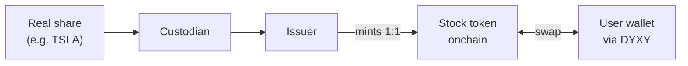

  

# DYXY Stocks

How DYXY gives access to tokenized US stocks and ETFs: tokens backed 1:1 by real shares, traded with a regular swap, 24/7.

> This repository describes how the product works. It does not contain DYXY source code. User guide: [docs.dyxy.io/trade/stocks](https://docs.dyxy.io/trade/stocks/overview).

## How a tokenized stock works

1. The issuer buys the real share and holds it with a custodian.
2. The issuer mints a token representing that share, or a fixed fraction of it.
3. The user swaps stablecoins or other tokens for the stock token on DYXY.
4. The token sits in the user's own wallet and can be sold, moved or held.

It is not a derivative: no leverage, no funding, no liquidation.

## Issuers

| Issuer | Product | Network |
| --- | --- | --- |
| Ondo Global Markets | Ondo tokenized stocks and ETFs (e.g. TSLAon) | Ethereum, BNB Chain, Solana |
| Backed | xStocks (e.g. TSLAx) | Solana and other networks |
| Binance | bStocks (e.g. TSLAB) | BNB Chain |
| Robinhood | Robinhood stock tokens | Robinhood Chain |
| Coinbase | Coinbase tokenized stocks | Base |

Tokens of the same stock from different issuers are different assets with different terms. The issuer is shown on every market page.

## Trading

| Property | Behavior |
| --- | --- |
| Execution | Regular token swap, routed like any other [swap](https://github.com/dyxy-io/swap) |
| Hours | 24/7, including weekends and US holidays |
| Fractions | Fractional amounts supported |
| Custody | Token held in the user's wallet |
| Fee | DYXY trading fee on the traded amount, 10% less with a referral code |

## Off-hours pricing

When the US market is closed, the token price is set only by onchain supply and demand. It can drift from where the share will open, and spreads can be wider.

| | US stock market | Stock token on DYXY |
| --- | --- | --- |
| Weekdays | 13:30 to 20:00 UTC (regular session) | 24 hours |
| Weekends | Closed | 24 hours |
| US holidays | Closed | 24 hours |

## Corporate actions and eligibility

- Dividends, splits and other corporate actions are handled according to each issuer's terms. Tokens usually carry no voting rights.
- Issuers typically exclude US persons and residents of some other jurisdictions. Users are responsible for checking their own eligibility.

## License

Text and diagrams in this repository are licensed under [CC BY 4.0](LICENSE). The DYXY name and logo are not covered by this license.
